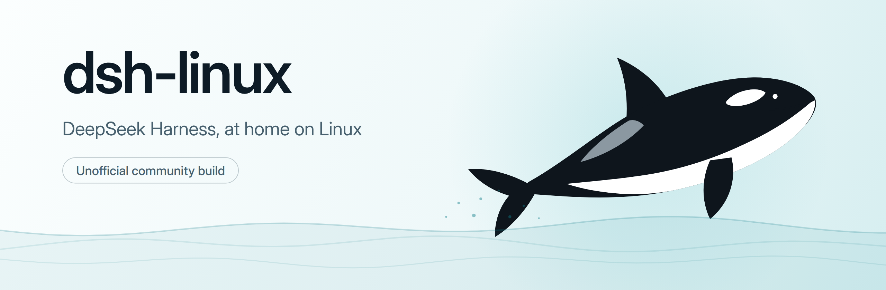
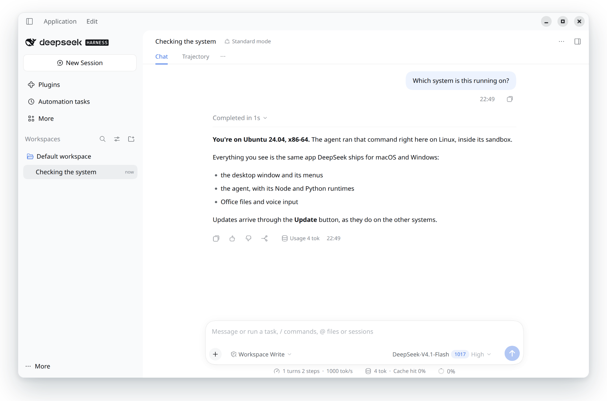

<p align="center">
  <picture>
    <source media="(prefers-color-scheme: dark)" srcset="docs/assets/banner-dark.png">
    
  </picture>
</p>

<p align="center">
  <a href="https://github.com/NahuelGenchi/dsh-linux/releases/latest"></a>
  
  <a href="LICENSE"></a>
</p>

<p align="center">
  DeepSeek Harness ships for macOS and Windows, but not for Linux. 🐋<br>
  This project brings the real desktop app over: the same window, the same agent and the same version,<br>
  with updates that arrive through the app's own <b>Update</b> button.
</p>

<p align="center">
  <picture>
    <source media="(prefers-color-scheme: dark)" srcset="docs/assets/screenshot-dark.png">
    
  </picture>
  <br>
  <sub>The real app on Ubuntu 24.04. The command really ran, and the answer around it is a sample.</sub>
</p>

## Install

Paste this into a terminal. It needs no root, and it installs for your user only.

```bash
curl -fsSL https://raw.githubusercontent.com/NahuelGenchi/dsh-linux/main/get.sh | sh
```

It downloads about 230 MB, checks the file against its hash and runs the installer. When it finishes, open **DeepSeek Harness** from your app menu, then sign in or add an API key as you would on any other system.

You need an x86-64 machine, with about 2.5 GB of free space while installing and 1 GB after that. If a system library is missing, the installer names it and prints the exact command that installs it.

<details>
<summary>Rather read before you run? Install by hand</summary>
<br>

Download `dsh-linux-x64.tar.xz` from the [latest release](https://github.com/NahuelGenchi/dsh-linux/releases/latest), then run these two commands. [`get.sh`](get.sh) is short and does the same, plus the hash check.

```bash
tar -xf dsh-linux-x64.tar.xz
```

```bash
sh dsh-linux-*-x64/install.sh
```

</details>

### Two small extras

On Ubuntu 23.10 and newer, Chromium's sandbox needs an AppArmor rule that names the app. The installer offers to add it, which asks for your password once. If you skip it, the app still runs without that sandbox, and you can add the rule later:

```bash
sudo sh ~/.local/share/deepseek-harness/setup-sandbox.sh
```

## What makes it different

Other Linux projects around DeepSeek Harness wrap its web interface or build it from source. This one takes another road. It starts from DeepSeek's own macOS release, checks DeepSeek's Apple signature, and swaps the macOS parts for the official Linux builds of the same components: Electron, Node, Python and the native modules.

So what you run is the release DeepSeek shipped, plus a few small patches that you can read in [one file](port/lib/patches.mjs). When DeepSeek publishes a new version, it comes to Linux through the same button as everywhere else.

## Updates

The **Update** button appears when a new version is out, and **Application > Check for Updates…** works too. DeepSeek publishes no Linux feed, so the app reads the macOS feed, downloads that release and rebuilds it for Linux on your machine. This usually takes about a minute and needs 4 GB of free space.

Nothing reaches you unchecked. The release must carry DeepSeek's real signature, every native part must pass a test, and the new build must start once with its windows hidden before the app offers the restart. If any of that fails, the update stops with a message and your version stays as it was. To go back to the version before the last update:

```bash
~/.local/share/deepseek-harness/deepseek-harness --rollback
```

A future release can still catch the port out, so the port can be fixed from here. Before each update, the app asks this project's releases for a newer engine, and takes one only if the key pinned in the app signed it. Your IP address reaches GitHub at that moment, and nothing else is sent. An engine runs with your user's rights, so this means trusting whoever holds that key. To turn it off for good:

```bash
touch ~/.local/share/deepseek-harness/no-engine-fixes
```

If DeepSeek requires an update that can't be prepared for Linux, the app lets you keep your current version until you quit, and tries again on its next start. DeepSeek may no longer support that version, so some things may stop working.

The whole story, including what this can't promise, is in [docs/updates.md](docs/updates.md).

## Good to know

**Closing the window keeps the app running,** as on Windows. Reopen or quit it from the tray icon, or quit with Ctrl+Q. GNOME only shows tray icons with the AppIndicator extension, which Ubuntu includes. Without it, launching the app again brings the window back.

**Your name may not show.** The sidebar may say "Signed in to DeepSeek" instead of your name or email, and your balance may not show. You are still signed in. DeepSeek's firewall answered the app's profile request with a 403 in testing, and only DeepSeek can change that.

**How the app names itself.** Update checks reach the server as `desktop-mac`, because the app reports that for every system except Windows, and Linux needs the update notices for the macOS releases. Account requests go out as `web`, because the app only names macOS and Windows there.

**The agent's sandbox works as on macOS.** In Workspace Write, commands can only write to the workspace and temporary folders. Everything else stays open to them: your files to read, the network, your `gh` login, the desktop, sound and other apps. `xdg-open` opens things outside the sandbox, as `open` does on macOS, and **Full access** in the same menu turns the sandbox off. On a kernel without Landlock, the app falls back to `bubblewrap`, which cuts commands off from the desktop.

**Tested on x86-64 only.** It runs on Ubuntu 22.04, 24.04 and 26.04, Debian 12 and Fedora 44. The Office engine is DeepSeek's official WASM build, since it publishes no native Linux one.

## Uninstall

```bash
~/.local/share/deepseek-harness/uninstall.sh
```

Your sessions and settings stay in `~/.dsh` and `~/.config/DeepSeek Harness`.

## Read more

Everything above has been tested, and the documents below show how, including what could not be verified.

| Document | What it covers |
|---|---|
| [SECURITY.md](SECURITY.md) | What protects you, what doesn't, and how to report a problem |
| [docs/updates.md](docs/updates.md) | How updates survive DeepSeek's changes, and how fixes are delivered |
| [docs/testing.md](docs/testing.md) | Every check on the current package, and the known limits |
| [docs/performance.md](docs/performance.md) | What made the package smaller and updates faster |
| [docs/bugs-fixed.md](docs/bugs-fixed.md) | The bugs found by breaking things on purpose |

## How it works

[`port/port.mjs`](port/port.mjs) is the whole engine, and each installed copy carries it for its own updates. It checks the release's Apple signature against a pinned root certificate and DeepSeek's team ID, then replaces every package marked macOS-only with the Linux twin the release itself declares, verified by npm's SHA-512. `sharp` is the one exception: it uses its WebAssembly build, because its Linux build crashes when Electron has the system's GLib loaded. The engine compiles `node-pty`, adds Electron, Node and Python, verified by their published SHA-256, patches the app, runs a native check and starts the result once in a throwaway home.

There are two kinds of patch. Without a required patch the app wouldn't be safe, start, update again or run its tools, so if one no longer fits, the update stops and your version stays. An optional patch only changes how the app looks or behaves day to day, such as the title bar, the tray icon or Ctrl+Q, so a release that moved that code is built without it, and the update log names what was left out.

The engine also keeps each copy small. It leaves macOS files out, removes third-party sources, documents and test folders that nothing can load, and adds Python bytecode for the Office and data packages. An update hard-links unchanged files from the installed version instead of copying them.

## Build it yourself

You need Node 22 or newer, and Docker so the terminal addon is built against an old glibc. Pass a macOS release, either the `.zip` from DeepSeek's feed or the `Contents` folder of the app:

```bash
./build-package.sh deepseek-harness-mac-arm64.zip
```

The package lands in `dist/`. Compression takes most of the build and about 4 GB of memory, so for a quick test build set `XZ_OPT='-T8 -6'`. The helpers in [`test/`](test) check a build on a private X server in Docker, and [docs/testing.md](docs/testing.md) explains how to run them.

## For DeepSeek

The best outcome for this project is an official Linux build that makes it unnecessary, and anything useful here is yours to take. Until then, three things would help Linux users a lot: letting Linux account requests through the firewall, giving Linux its own client label such as `desktop-linux`, and saying how forced updates should behave when one can't be built for Linux. A private contact for security topics would also be welcome, since `SAFETY.md` doesn't list one.

## Credits

DeepSeek Harness is made by [DeepSeek](https://github.com/deepseek-ai/deepseek-harness) and comes under the MIT license. dsh-linux is an independent community project, and DeepSeek did not make it, doesn't endorse it and doesn't support it. "DeepSeek" and "DeepSeek Harness" are DeepSeek's trademarks, used here only to say what this project works with. The port's own code is under the [MIT license](LICENSE), and [NOTICE.md](port/packaging/NOTICE.md) has the details for everything in the package.
